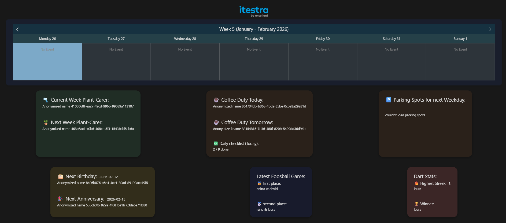
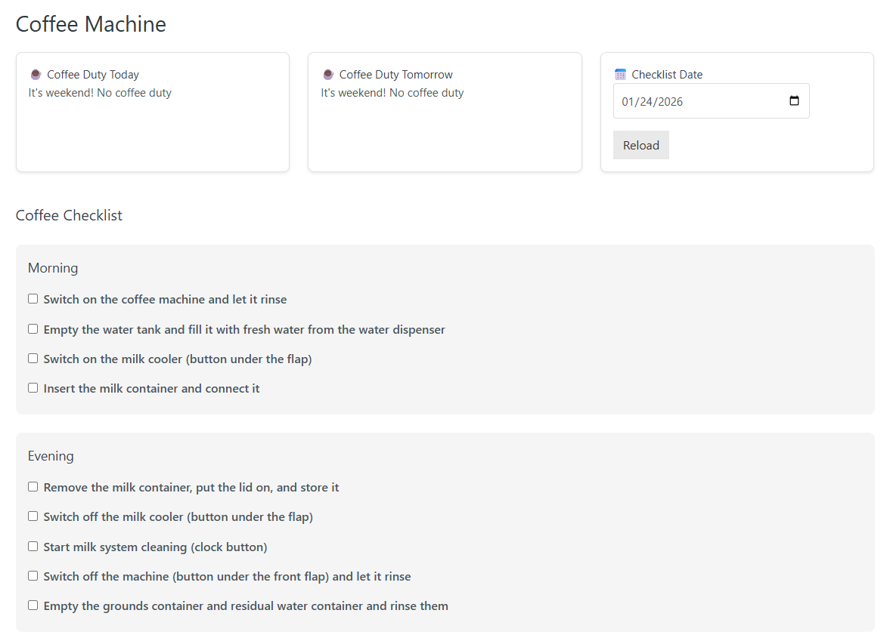
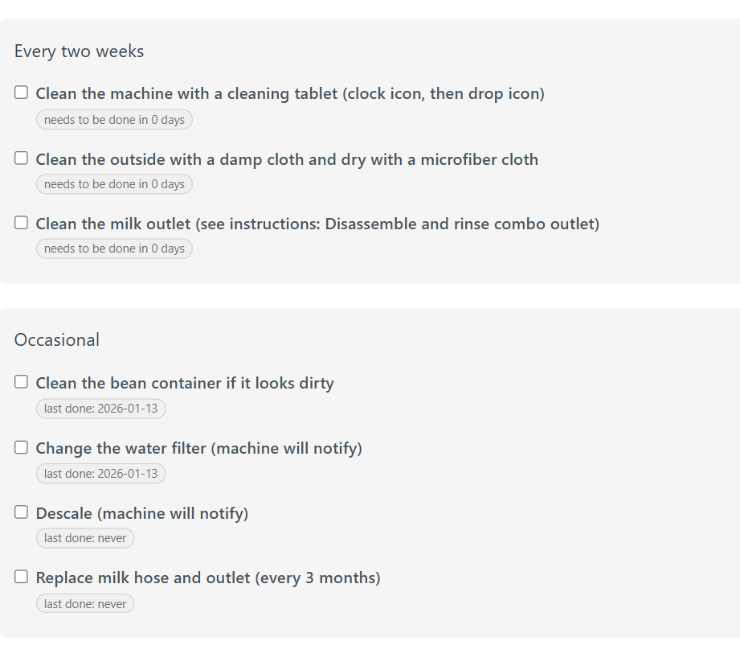

# Office Dashboard – Mattermost Reminders & Coffee Duty

The **Office Dashboard** is a web application for Itestra GmbH in Stuttgart, developed in a university project by a team of three. It is an information screen for the office: it shows birthdays, work anniversaries, the weekly plant carer and the coffee duty, and it sends reminders to employees through Mattermost. Employee data comes from the ERP system Odoo.

Tech stack: Java (backend), Vue.js (frontend).

This repository contains the parts I implemented: the **Mattermost integration** and the **coffee duty**. The other features (Odoo integration, calendar, darts, foosball, parking spots) were mainly built by my teammates.

## My contribution

### Mattermost reminders

A bot posts automatic reminders to Mattermost, so employees don't have to check the dashboard.

| Reminder | When | Where |
|---|---|---|
| Birthday and work anniversary | one week before | Mattermost channel |
| Plant care | every Monday morning | direct message to the responsible employee |

For testing, a test endpoint triggers all reminders immediately, and plant care messages can be redirected to a test user.

- `Mattermost.java`: client for the Mattermost API (channel posts and direct messages)
- `ReminderScheduler.java`: scheduled jobs that create and send the reminders
- `ReminderTestController.java`: endpoint to trigger the reminders manually
- `ReminderSchedulerTest.java`: unit tests with a mocked Mattermost client

### Coffee duty

Every weekday one employee has coffee duty, rotating alphabetically (none on weekends). The dashboard shows who is on duty today and tomorrow, and the cleaning tasks of the coffee machine can be checked off per day. Recurring tasks show when they were last done and whether they are due.

- `coffee/`: REST API and database access for the duty rotation and the cleaning tasks
- `CoffeeView.vue`: frontend view for the duty and the checklist

| Coffee duty | Checklist |
|---|---|
|  |  |

## Configuration

The Mattermost connection is configured through Spring properties; no credentials are stored in the code: `mattermost.url`, `mattermost.token`, `mattermost.channel`, `mattermost.botUserId` and the optional `plantcare.test-user`.

## Note

This repository contains only my part of a larger team project. To run it, you also need the rest of the application (Odoo employee data, database, remaining backend and frontend).